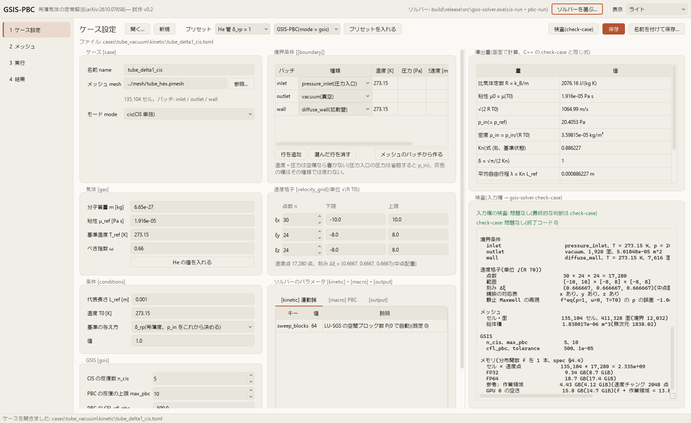
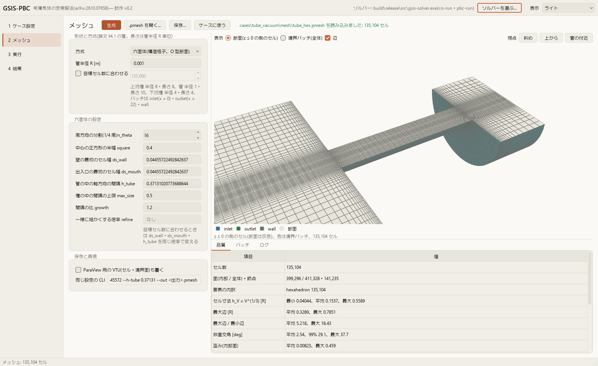
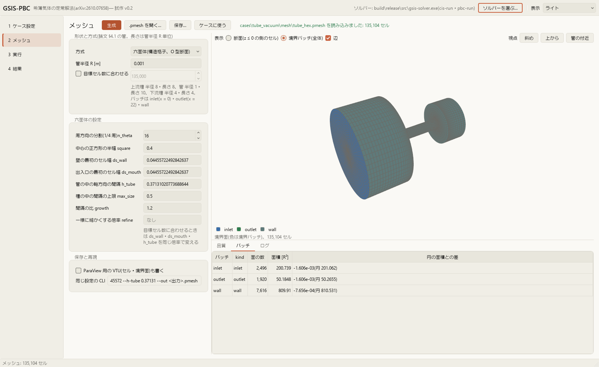
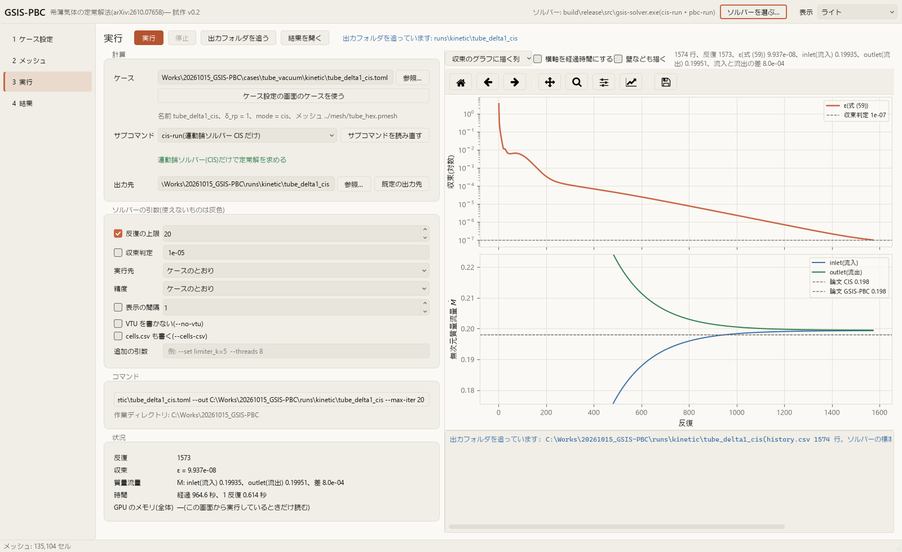
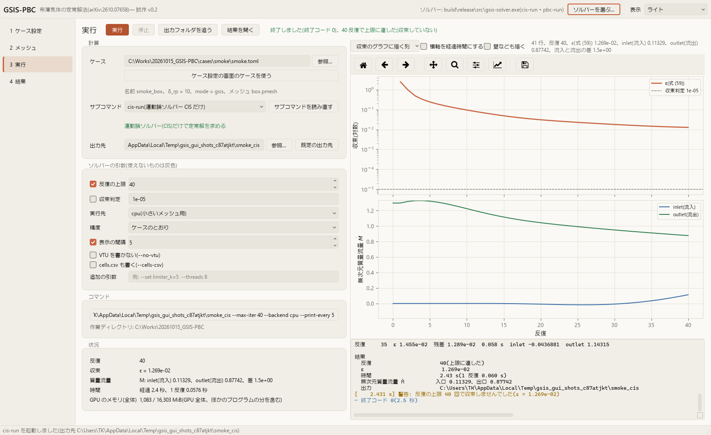
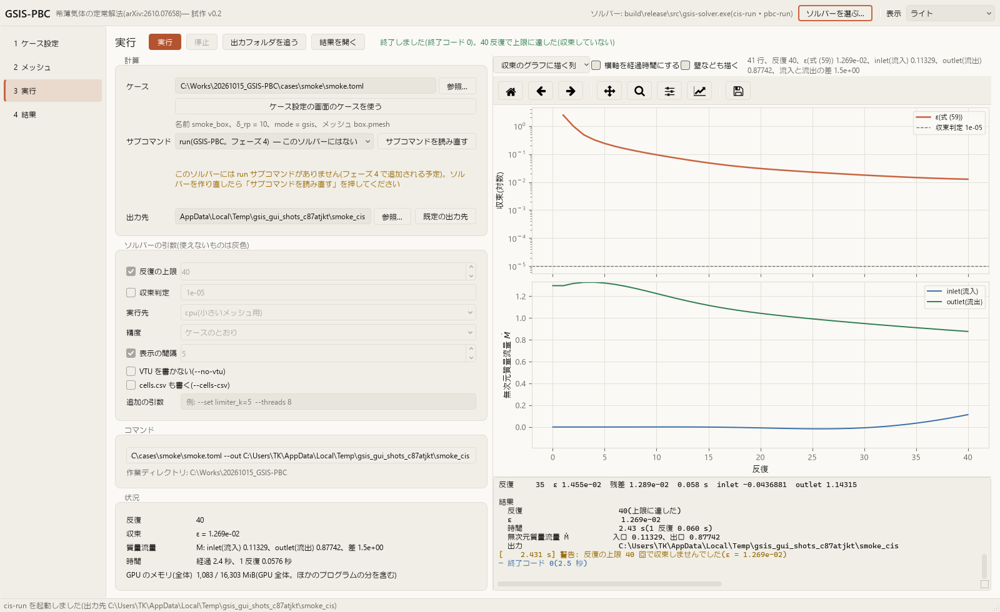

# GUI(gsis-gui、試作 v0.2)

- 版: 0.2 / 2026-10-16(v0.1 へのユーザーの意見を受けて、結果の画面に流線・任意の断面・線上の分布を足した)
- 仕様: `docs/spec.md` §4.1・§4.6・§6
- 置き場所: `python/src/gsis_tools/gui/`(サブパッケージ `gsis_tools.gui`)、試験は `python/tests/test_gui_*.py`、画面の画像は `docs/gui_screenshots/`

管ケース(円管 → 真空)の一連の流れ ── ケース設定 → メッシュ → 実行 → 結果の比較 ── を画面で通すための試作。
ソルバー `gsis-solver` とは、ファイル(ケース TOML・メッシュ・結果)とサブプロセスだけでやり取りする。GUI がなくても、
すべての機能は CLI(`gsis-solver`・`gsis-tools`)とスクリプトで使える。

## 1. 起動

リポジトリのルートで実行する。初回は extra `gui` の依存を入れるので少し時間がかかる。

```powershell
uv run --project python --extra gui gsis-gui
uv run --project python --extra gui gsis-gui --case cases\tube_vacuum\kinetic\tube_delta1_cis.toml
uv run --project python --extra gui gsis-gui --results runs\kinetic\tube_delta1_cis --theme dark
```

| 引数 | 内容 |
|---|---|
| `--theme system\|light\|dark` | 表示モード(既定は前回の選択、初回は `system` = OS の設定に合わせる) |
| `--case FILE.toml` | 起動時にケースを開く |
| `--results RUN_DIR` | 起動時に出力フォルダを読み込み、結果の画面を出す |
| `--page case\|mesh\|run\|results` | 最初に出す画面 |
| `--solver EXE` | 使う `gsis-solver`(既定は `build/release/src/gsis-solver.exe`、なければ `build/release-cpu/…`) |
| `--offscreen` | 画面を出さずに動かす(確認用。Qt の offscreen、3D は静止画の方式) |
| `--quit-after 秒` | 指定した秒数で終わる(起動の確認用) |

`python -m gsis_tools.gui` でも起動できる。

| 依存(extra `gui`、`python/pyproject.toml`) | 版(2026-10-16 に解決) | 用途 |
|---|---|---|
| PySide6-Essentials | 6.12.0 | 画面(Qt 6)。WebEngine などを含む PySide6 本体は大きいので、必要な部分だけの Essentials にした |
| pyvista / pyvistaqt | 0.49.1 / 0.13.1 | 3D 表示(VTK 9.7.1) |
| tomlkit | 0.15.1 | ケース TOML の読み書き(コメントと並びを保つ) |

設定(表示モード、ソルバーの場所、最近開いたファイル)は `%APPDATA%\GSIS-PBC\gsis-gui.ini` に保存する。

| 環境変数 | 内容 |
|---|---|
| `GSIS_GUI_SETTINGS` | 設定ファイルの場所を変える(試験・スクリーンショットで使う) |
| `GSIS_GUI_3D` | 3D の方式: `interactive`(既定)/ `static`(オフスクリーンの静止画)/ `none` |
| `GSIS_ROOT` | リポジトリのルート(既定はパッケージの場所から探す) |

## 2. 画面

左の一覧で 4 つの画面を切り替える。上のツールバーに、使っているソルバー(と使える実行のサブコマンド)、ソルバーの選択、表示モードがある。

### 2.1 ケース設定



- 管ケースの TOML(`docs/spec.md` §4.6)を節ごとの入力欄で編集する: `[case]`・`[gas]`・`[conditions]`・`[[boundary]]`・`[velocity_grid]`・`[gsis]`・`[kinetic]`・`[macro]`・`[output]`
- **プリセット**: He 管 δ_rp = 1 / 10 / 100 / 1000(論文 §4.1: He、管半径 1 mm、T0 = 273.15 K、30×24×24 の速度格子 [−10, 10] × [−8, 8]²、GSIS は n_cis = 5・max_pbc = 10・cfl_pbc = 500・tolerance = 1e-5、メッシュは `cases/tube_vacuum/mesh/tube_hex.pmesh`)。mode は gsis / cis を選ぶ。プリセットは新しいケース(保存するまでファイルはない)
- **導出量**(右上): R、μ0、√(2RT0)、p_in、ρ_in、Kn、δ、平均自由行程、質量流量の基準、分布関数のメモリ。C++ の `derive_quantities` と同じ式で画面が計算する(check-case の表示と有効数字 6 桁で一致することを試験で確かめている)
- **検査**: 入力欄の誤り(空欄、負の値、境界条件に要る値の不足、メッシュにないパッチ、境界条件のないパッチ)はその場で表示する。「検査(check-case)」と「保存」は `gsis-solver check-case` を実行して結果を右下に出す。保存は check-case が通ってから書く(エラーなら保存するか尋ねる)
- **読み書き**: 元のファイルのコメント・並び・書き方を保つ(値を変えたキーだけを書き換える。変えなければ 1 文字も変わらない)。`[gsis]` は、既定値(5、10、500、1e-5)と同じで元のファイルにない項目は書かない。境界条件の種類に要らない値(灰色の欄)は書かない
- メッシュのパスは TOML の場所からの相対パスで書く(C++ と同じ規則)。別の場所に保存するときは相対パスを直す
- `[kinetic]`・`[macro]` は既知のキーを一覧から選べる(型・既定値・説明を出す。知らないキーは黄色で示す。ソルバーはエラーにする)

### 2.2 メッシュ




- `gsis_tools.geometry.tube` の `generate_tube_hex`(構造六面体、O 型断面)・`generate_tube_tet`(gmsh の四面体)で管メッシュを作る。設定は `gsis-tools mesh tube` と同じ(目標セル数、管半径、六面体の n_theta・ds_wall・ds_mouth・h_tube・max_size・growth・refine、四面体の max_size・h_tube・gradient・アルゴリズム・スレッド数)。同じメッシュを CLI で作るコマンドも表示する
- 生成と読み込みは別スレッド(画面は固まらない)。四面体は gmsh をメインスレッドで先に初期化してから別スレッドで作る
- **品質**: セル数、要素の内訳、セル寸法 h_V(R 単位)、最大辺、辺の比、非直交角(平均・99%・最大)、歪み、体積比、体積(円柱の値との差)、領域別(上流槽・管・下流槽)のセル数と h_V、pmesh §4 の検査。**パッチ**: 面の数と面積(円の面積との差)
- **3D 表示**: 境界パッチを色分けした表面(入口は青、出口は緑、壁は灰緑)。「断面」は z ≤ 0 の側のセル(断面にかかるセルを含む)を見せ、断面のセルの形が分かる。視点は「斜め」「上から」「管の付近」
- 既存の `.pmesh` を開ける(metadata から設定を読み戻す)。保存は `.pmesh` と品質レポート(`<名前>_quality.md`)、必要なら ParaView 用の VTU。「ケースに使う」で、保存したメッシュをケース設定のメッシュにする

### 2.3 実行




- `gsis-solver` のサブコマンド `run`(フェーズ 4)・`cis-run`・`pbc-run` を QProcess で起動・停止する。作業ディレクトリはリポジトリのルート。`run` があればそれを既定にする
- 使えるサブコマンドと引数は `gsis-solver --help` から読む。**ないサブコマンド**は一覧に「このソルバーにはない」と出し、選ぶと注意を表示し、実行しようとすると理由(`run` はフェーズ 4 で追加予定)を窓で知らせて起動しない。ソルバーを作り直したら「サブコマンドを読み直す」
  
- 引数: 出力先 `--out`(既定はソルバーと同じ `runs/kinetic/<名前>` など)、反復の上限(`--max-iter` / `--iterations`)、収束判定(`--tol` / `--tolerance`)、実行先・精度(cis-run)、表示の間隔、`--no-vtu`、`--cells-csv`、追加の引数。使い方の行にない引数は渡さず、その旨を出す。出力先に前の結果があれば上書きするか尋ねる
- **ログ**: 標準出力と標準エラー(UTF-8)をそのまま出す(エラーは赤、警告は黄)
- **グラフ**(1 秒ごとに `history.csv` を読み足す): 上は収束(cis-run は ε、pbc-run は更新量と質量の残差。「収束のグラフに描く列」で選べる)と収束判定の線。下はパッチごとの質量流量(管ケースは論文の無次元質量流量 Ṁ、入口は流入・出口は流出を正)と、論文 Table 1 の値の線(管のメッシュのときだけ)。横軸は反復か経過時間
- **状況**: 反復、ε(または更新量)、Ṁ と流入・流出の差、経過時間と 1 反復の時間、GPU のメモリ(nvidia-smi で 5 秒ごと。GPU 全体の使用量で、ほかのプログラムの分を含む)
- **停止**: プロセスを終了させる(Windows のコンソールのプログラムは穏やかな終了の要求を受けないため kill)。出力は途中まで残る
- **出力フォルダを追う**: 実行せずに、指定した出力フォルダの `history.csv` を読んで表示する(別に起動した計算や、終わった計算を見る)。summary.json があれば、そのケースと収束判定を使う
- 終わったら「結果を開く」で結果の画面に移る

### 2.4 結果

出力フォルダ(`runs/` の下を探して新しい順に並べる。ほかの場所は「参照…」)を読む。タブは「3D 表示」「線上の分布」
「中心線(Fig.3)」「質量流量(Table 1)」「収束の履歴」「要約(summary.json)」。

VTU の読み込みは別スレッド(13.5 万セルで 2 秒前後)。3D 表示の計算(断面・等値線・流線)・線上の分布・中心線の作り直しも
別スレッドで 1 つずつ順に行い(`workers.JobRunner`。同じ格子を 2 つのスレッドで同時に触らない)、画面は出来上がったものを
描くだけにしている。設定を続けて変えたときは、最後の設定だけを計算する。

#### 3D 表示

左の設定は「場と表示」「断面」「流線」の 3 ページ。視点のボタンは「斜め」「上から」「断面に垂直」「管の付近」。「画像を保存…」で PNG。


- **場と表示**: 場(p、ρ、u、T、Ma、局所 Kn、q、σ、残差)と成分(大きさ・x・y・z、σ は 6 成分)。既定は無次元
  (p/p_in、ρ/ρ_in、u/√(2RT0)、T/T0、q/(p_in√(RT0))、σ/p_in)。表示は「3D(断面と奥の壁)」「断面(断面に垂直に見る)」
  「断面と等値線」「境界面(全体)」「なし(流線だけ)」。色の範囲は「領域全体」「表示しているもの」(断面の中の範囲。
  管を横切る断面の半径方向の変化が見やすい)「指定」。「領域の輪郭を薄く表示」で領域の表面を半透明で重ねる。
  視点を変えずに場だけを替えられる
- **断面**(任意の断面): プリセット「z = 0(xy 面)」「y = 0(xz 面)」「x 一定(yz 面、既定 X = 5)」と「自由」。原点(L_ref
  単位)と法線を入力できる(入力すると「自由」になる)。「法線の向きに動かす」のスライダーで、向きを変えずに断面を
  平行に動かす(放したときに作り直す)。「平面ウィジェットで動かす」で pyvista の平面ウィジェットを出し、マウスで
  断面を動かす・傾けることができる(離したときに作り直し、原点と法線の欄に入る。対話型の 3D 表示のときだけ)。
  「3D」の表示では、既定の斜めの視点から見て断面の奥の側の壁を描く。断面に垂直に見るときは、断面と管の付近の
  重なりに合わせて拡大する

  
  
- **流線**: セル値の速度を点へ補間し(`cell_data_to_point_data`)、VTK の流線(RK45)で積分する。種の置き方は
  「円盤」(中心・法線・半径。既定は管の入口の手前 x = 7、半径 1.5、法線 x)「線分」(点 A・B)「点の群」(球の中に乱数で。
  毎回同じ点)「断面上の 2 次元の流線」(「断面」のページの断面に速度を投影し、断面の上で積分する。種は断面のセルから
  選ぶ)。本数(種の数)、積分の向き(両方・流れの向き・逆向き)、長さの上限を選び、「流線を計算」で計算する。
  色は速さ |u|/√(2RT0)(2 次元の流線は面内の速さ)で、場のカラーマップと別のもの(cividis ↔ viridis)。
  「管(チューブ)のように描く」で太く描く。同じ設定の流線は覚えておき、場や表示を替えても計算し直さない

  
  
  

13.5 万セルの管の結果(`runs/kinetic/tube_delta1_cis`)での時間: 点への補間 0.1 秒、流線は種 60 個(両方の向きで 120 本・
4,110 点)0.9 秒・種 300 個(600 本・2 万点)4 秒、断面 0.01〜0.02 秒、断面上の 2 次元の流線(種 200 個)0.2 秒。
計算している間も画面は動く(20 ms ごとのタイマーの間隔は、描く時間を含めて最大 0.09 秒。試験で 0.5 秒未満を確かめている)。

#### 線上の分布


- 任意の 2 点 A・B(L_ref 単位)を結ぶ線の上の分布。プリセット「中心線(管の中、X = 0〜10)」「中心線(全体)」
  「管の直径(X = 5、y 方向)」「管の出口の直径(X = 9.9)」「下流槽の断面(x = 20)」と「任意」
- 点の数、描く量(p、ρ、u の各成分と大きさ、T、Ma、局所 Kn、q、σ など。最大 6 つを上下に並べる)、無次元、横軸
  (A からの距離 s・x・y・z・X)を選ぶ。値はセル値を点へ補間したもの(VTK の probe)。領域の外の点は描かない
- 「図を保存…」(PNG・SVG・PDF)、「CSV を書き出す…」(列: s, x, y, z と全部の量。列名は ASCII、例 `p/p_in`・
  `u_x/sqrt(2RT0)`・`T[K]`。領域の外は空欄)。「3D 表示に線を出す」で線を 3D 表示に重ねる
- 中心線を論文 Fig.3 と比べるのは次の「中心線(Fig.3)」のタブ(軸の近くのセル値に当てはめて r → 0 に外挿した値)。
  こちらは補間した値そのものなので、壁の近くなどで少し違う

#### 中心線・質量流量・履歴


- **中心線(Fig.3)**: p/p_in と u_x/√(2RT0) を横軸 X = x/L_ref − 8(管の入口 0、出口 10)で描き、論文 Fig.3 のデジタイズ値(GSIS-PBC の線、CIS の記号、δ = 100 は DSMC の記号)を重ねる。δ はこの計算の δ から自動で選ぶ(選び直せる)。表に差(計算 − 論文)の RMS・最大・その位置・平均を出す(論文の点の X で計算を線形補間し、線が欠けている X < 0.15 は使わない)。「図を保存…」(PNG・SVG・PDF)、「CSV を書き出す…」(中心線と、論文 GSIS-PBC の線をこの X で補間した列。差の表は `_diff.csv`)
- **質量流量(Table 1)**: summary.json の Ṁ(入口と出口の平均)を Table 1(参照値、論文の GSIS-PBC・CIS、反復回数)と並べ、差を出す(論文の GSIS-PBC との差が ±2% 以内なら緑、外なら黄。受け入れ基準 spec §1.4)。「今の計算を『比べる計算』に加える」で複数の計算(δ の違う計算)を並べられ、中心線の図にも破線で重ねられる。CSV に書き出せる
- **収束の履歴**: 実行の画面と同じグラフ(論文の Ṁ の線付き)。**要約**: summary.json の中身

δ = 1 の CIS(`runs/kinetic/tube_delta1_cis`)で、中心線の差は論文の CIS と p で RMS 0.0054・最大 0.0087、u_x で RMS 0.023・最大 0.050(X = 9.94)と、`docs/phase2_report.md` の値と同じになる(試験で確かめている)。

### 2.5 表示モード(配色)


- TK 標準の warm clay テーマ。色は `gsis_tools/gui/theme.py` のトークン(ライト・ダークで同じ名前の 2 組)だけから使い、Qt のパレットとスタイルシート(`qtheme.py`)、matplotlib の rcParams、3D 表示の背景・文字に当てる
- モードは「システムに合わせる」(既定、OS の設定が変わると追従)/ ライト / ダーク。ツールバーで切り替え、設定に保存する
- アクセント(テラコッタ)は主ボタン・選択・フォーカス・進捗・チェックだけに使う。グラフは系列色 6 色、連続量のカラーマップは cividis(既定)/ viridis
- その他のダークの画面: `13_dark_results_3d.png`、`15_dark_case.png`、`16_dark_mesh.png`、`23_dark_results_streamlines.png`
- 3D 表示の色の帯の題は VTK の字体で描くので、日本語と一部の記号を使わない(`|u|` は `u_mag`、ρ は `rho` にして描く)

## 3. ソルバーとの受け渡し

| 方向 | ファイル・プロセス | GUI の使い方 |
|---|---|---|
| GUI → ソルバー | ケース TOML | 画面で書く(tomlkit。コメントを保つ)。check-case には一時フォルダの写し(メッシュは絶対パス)を渡す |
| GUI → ソルバー | `gsis-solver --help` | サブコマンドの一覧と、使い方の行にある引数(`--out` など)を読む |
| GUI → ソルバー | `gsis-solver check-case <toml>` | 出力をそのまま表示。終了コード 0 で合格 |
| GUI → ソルバー | `gsis-solver run\|cis-run\|pbc-run <toml> --out <dir> …` | QProcess で起動。標準出力・標準エラーは UTF-8 として読む。終了コード 0 / 1(エラー)/ 2(引数の誤り、「知らないサブコマンド」を含む)で説明を変える |
| ソルバー → GUI | `<out>/history.csv` | 1 秒ごとに後ろだけ読む(途中で切れた行は次回に回す。作り直されたら読み直す。実行を始める前の古いファイルは読まない) |
| ソルバー → GUI | `<out>/summary.json` | 反復、収束、時間、`mass_flow.M_dot`(cis-run・run)または `M_dot`(pbc-run)、`patches`(パッチ名と種類)、`reference`(無次元化の基準量。cis-run・run にあり、pbc-run にはない)、`delta`、`tolerance`、`mode`(run の gsis / cis)、`case_file` |
| ソルバー → GUI | `<out>/fields.vtu`(cis-run)・`cells.vtu`(pbc-run)・`boundary.vtu` | pyvista で読む。セル値は SI(rho, u/U, T, p, …)。ない場はリストに出さない |
| ソルバー → GUI | `<out>/cells.csv`(任意) | VTU がないときに中心線をこれから作る |
| GUI → gsis_tools | `generate_tube_hex` / `generate_tube_tet`、`read_pmesh` / `write_pmesh`、`compute_quality`、`format_report` | 関数を直接呼ぶ(メッシュの画面) |

`history.csv` の列の使い方:

| 列 | cis-run | pbc-run | run(フェーズ 4) |
|---|---|---|---|
| 反復 | `iteration` | `iteration` | `iteration` |
| 収束(既定で描く列) | `epsilon` | `update_p`・`update_u`・`update_T`・`residual_mass` | `epsilon`(ほかに `eps_*`・`pbc_change` なども選べる) |
| 質量流量 | `mdot_<patch>_nd`(なければ `_kg_s`) | `mdot_<patch>`(無次元) | `mdot_<patch>_nd`(運動論側、実線)と `mdot_pbc_<patch>_nd`(PBC 側、同じ色の破線。流入と流出の差には入れない) |
| 経過時間 | `time_total_s` | `elapsed_seconds` | `time_total_s` |

列は名前で探すので、知らない列は「収束のグラフに描く列」で選べるだけで、あっても困らない。`run` の列は、
開発中の `build/phase4/src/gsis-solver.exe` の出力(`runs/gsis/_diag/` の history.csv・summary.json、2026-10-16)で確かめた。

- **無次元質量流量**: ソルバーの無次元の質量流量(ρ_ref √(RT0) L_ref² 単位、外向きが正)に √(2/π) を掛けると論文の Ṁ = ṁ / (√π L_ref² p_in / √(2RT0)) になる(p_ref = p_in のとき。kg/s の列は質量流量の基準で割る)。ケースが `delta_rp` で与えられたときだけ Ṁ にし、それ以外は無次元の値のまま描く
- **中心線**: 軸の近く(r < r_max、既定 0.3 L_ref)のセルに、同じ x の層ごとに a + b r² を最小二乗で当て、r = 0 の値 a を取る(`cases/tube_vacuum/kinetic/centerline.py` と同じ。層がない四面体では x の区間ごとに a + b (x − x_c) + c r²)。VTU のセル中心から作った値は、cells.csv(FV の重心)から作った値と 1e-8 以内で一致する
- **論文との比較**: `reference/paper_2610.07658/` の `table1_tube.csv` と `fig3_*.csv` を読む。論文の線・記号は管のメッシュのとき(メッシュの metadata が `gsis_tools.geometry.tube` か、ファイル名が tube で始まる)だけ実行の画面に出す

## 4. 試験

```powershell
$env:QT_QPA_PLATFORM = "offscreen"
uv run --project python --extra gui pytest python/tests
```

- 127 件(既存 57 件 + GUI 70 件)。所要 30〜40 秒。extra `gui` がない環境では、GUI の試験のうち Qt・pyvista・tomlkit が要る 5 ファイルは飛ばし、既存の 57 件と残りの GUI の試験 13 件(履歴・ソルバーの呼び出し)が通る(別の仮想環境で確かめた。2026-10-16)
- 画面の試験は `QT_QPA_PLATFORM=offscreen`(試験の中でも既定にする)、3D は静止画の方式(`GSIS_GUI_3D=static`)で描く。確認の窓は差し替えて止まらないようにしている
- ソルバーを使う試験(check-case、pbc-run・cis-run の短い実行)は `build/release/src/gsis-solver.exe` がなければ飛ばす。実行は smoke ケース(128 セル)を CPU で数反復だけにし、GPU は使わない

| 試験ファイル | 確かめること |
|---|---|
| `test_gui_casefile.py` | 既存の TOML 10 個が変更なしで 1 文字も変わらない往復、値を変えたときの往復とコメントの保持、プリセット 4 つ、浮動小数点の書き方、導出量(check-case の表示と一致)、入力の検査、メッシュの相対パス、書いた TOML を check-case が通すこと |
| `test_gui_history.py` | cis-run・pbc-run・run(PBC 側の流量の列を含む)・kg/s だけの列の解析、Ṁ への換算と向き、追いかけ読み(行の途中、作り直し、古いファイル)、既存の出力の最終行が summary.json と一致 |
| `test_gui_centerline.py` | 層ごとの当てはめ(2 次の場で厳密)、区間の当てはめ(四面体の並び)、既存の `centerline.csv` との一致、VTU と cells.csv の一致、CSV の書き出し |
| `test_gui_reference.py` | Table 1 の値、Fig.3 のファイル、差の計算(範囲外の点を除く)、phase2_report の値の再現 |
| `test_gui_solver.py` | `--help` の解析、引数の組み立て(使えない引数は省く)、`run` がないときの扱い、失敗の説明 |
| `test_gui_fields.py` | 流線の種(円盤・線分・点の群)、断面のプリセット・量の名前・CSV の列名、斜めの法線の断面と等値線・「3D」で描く壁の側・色の範囲の 3 つの方式・断面を動かせる範囲、一様な流れの流線(向き・覚えておく・逆向き)、断面上の 2 次元の流線(断面の上にあること、面内の流れがないとき)、線上の標本(1 次の場で厳密)と CSV |
| `test_gui_app.py` | 画面の組み立てと切り替え、テーマ(スタイルシート・パレット・matplotlib・設定の保存)、ケース設定の入力欄を通した往復と保存、プリセット、check-case(合格と不合格)、run がないときの注意、pbc-run の実行と履歴、停止、六面体・四面体のメッシュ生成と保存、結果の読み込み(解析解を入れた合成データと既存の出力)、Table 1 と中心線の差、書き出し、3D の静止画、任意の断面・流線(3 次元と断面上の 2 次元)・線上の分布と CSV を画面の操作から通す、13.5 万セルの結果で流線を計算している間に画面が固まらないこと(20 ms のタイマーの間隔が 0.5 秒未満)、色の帯の題の字の置き換え |

## 5. スクリーンショットの作り方

```powershell
uv run --project python --extra gui python -m gsis_tools.gui.screenshots                 # 画面を出さずに撮る(既定。3D は静止画の方式)
uv run --project python --extra gui python -m gsis_tools.gui.screenshots --interactive   # 通常の表示で窓を出して撮る
```

`docs/gui_screenshots/` の 23 枚は、画面を出さない方式(Qt の offscreen、3D は VTK のオフスクリーンの静止画)で撮った
(2026-10-16。窓は出ず、40 秒ほどで終わる。字体は `C:\Windows\Fonts` を使うので、通常の表示と同じ字になる)。
平面ウィジェットは対話型の 3D 表示だけのものなので、画像にはない。データは `runs/` の既存の出力
(`runs/kinetic/tube_delta1_cis`・`tube_delta10_cis`、`runs/macro/tube_hex_d100_nsf`・`tube_hex_d1000_nsf`)を読むだけで、
実行の画像(05)は smoke ケースの cis-run を CPU で 40 反復だけ実行した(出力は一時フォルダ)。

## 6. 構成

| モジュール | 内容 |
|---|---|
| `app.py`・`main_window.py`・`context.py` | 起動、メインウィンドウ(4 画面とツールバー)、画面で共有する状態(ソルバー、テーマ、設定) |
| `pages/case_page.py`・`mesh_page.py`・`run_page.py`・`results_page.py` | 4 つの画面 |
| `pages/results_3d.py`・`line_profile.py` | 結果の画面の「3D 表示」(場と表示・断面・流線)と「線上の分布」のタブ |
| `widgets/` | 入力欄・ログ・キーと値の表(`common.py`)、matplotlib の図(`plots.py`)、履歴のグラフ(`history_plot.py`)、3D 表示(`vtk_view.py`) |
| `theme.py`・`qtheme.py` | 色のトークンと matplotlib(Qt なし)、Qt のパレット・スタイルシート・モードの切り替え |
| `casefile.py` | ケース TOML の読み書き・プリセット・導出量・検査(Qt なし) |
| `history.py`・`centerline.py`・`reference.py`・`results.py`・`solver.py`・`paths.py` | 履歴、中心線、論文データ、出力フォルダ、ソルバーの呼び出し、パス(Qt なし。試験で直接使う) |
| `meshgen.py`・`fields.py` | メッシュ生成と品質・3D 用のデータ、VTU の場・任意の断面・等値線・流線・線上の標本と CSV(pyvista。Qt なし) |
| `workers.py` | 別スレッドの処理(QThread)、結果の画面の計算を 1 つずつ順に行う `JobRunner`、logging の受け渡し |
| `screenshots.py` | スクリーンショットの作成 |

## 7. 未実装の点・既知の制約

- **フェーズ 4 の `run`**: `build/release` のソルバーにはまだない(一覧に「このソルバーにはない」と出る)。開発中の `build/phase4` のソルバーでは、`--help` から `run` と引数(`--out`・`--max-iter`・`--tol`・`--backend` など)を読み、GUI のすべての項目が渡せること、出力(history.csv・summary.json)が読めることを確かめた。GPU を長く使うので、`run` の実際の実行は GUI から試していない
- 結果の 3D 表示に、等値面と境界面の値(`boundary.vtu` の質量流束など)の表示はない。流線・任意の断面・線上の分布は v0.2 で足した
- 断面の色はセルの値(セルごとに一定)で、等値線・流線・線上の分布は点へ補間した値から作る。そのため等値線はセルの大きさの段差を含み、壁に接するセルの値は壁の上の値ではない
- 平面ウィジェットは対話型の 3D 表示のときだけ使える(画面を出さない方式・静止画の方式では使えない)。ウィジェットの矢印は、正面から見ると少し大きく見える
- 分布関数の断面表示(spec §6 の任意の機能)はない(ソルバー側にプローブ出力が要る)
- 停止はプロセスの強制終了なので、止めた時点の summary.json・VTU は書かれない(履歴は残る)
- 実行の画面は 1 つの計算だけを扱う(複数の計算を並べて実行・監視しない)。ソルバーの標準出力は、この画面から起動したときだけ表示できる(「出力フォルダを追う」は history.csv だけ)
- メッシュの画面は管(論文 §4.1 の形)だけ。平板などほかの形、gmsh の `.msh` の変換は CLI(`gsis-tools`)を使う
- 3D の表示は 13.5 万セルで実用的な速さ(VTU の読み込みと中心線 2 秒前後、断面 0.02 秒、流線は種 60 個で 0.9 秒・300 個で 4 秒)。さらに大きいメッシュと、種が数千個の流線は確かめていない(別スレッドなので画面は固まらないが、時間はかかる)
- Windows 11 だけで確かめた。Linux では `QT_QPA_FONTDIR`(offscreen のフォント)などの扱いを確かめていない

## 8. ソルバー側への要望(統括役・フェーズ 4 の担当へ)

1. 穏やかな停止の手段(例: 出力先に `STOP` というファイルができたら、その反復で止めて summary.json と VTU を書く)。今は強制終了しかできず、止めた計算は結果の画面で 3D・中心線・Ṁ を見られない
2. `pbc-run` の summary.json にも、cis-run・run と同じ `reference`(無次元化の基準量)・`delta`・`tolerance` を入れてほしい(今は GUI がケース TOML から計算している。ケースが動かされると無次元化できない)
3. history.csv に GPU のメモリの列があると、nvidia-smi(GPU 全体の値で、ほかのプログラムの分を含む)より正確に出せる
4. (確認済み)`run` の引数の名前が cis-run と同じ(`--out`・`--max-iter`・`--tol`)で、history.csv に `epsilon`・`mdot_<patch>_nd` があるので、GUI はそのまま使える。この形を保ってほしい
