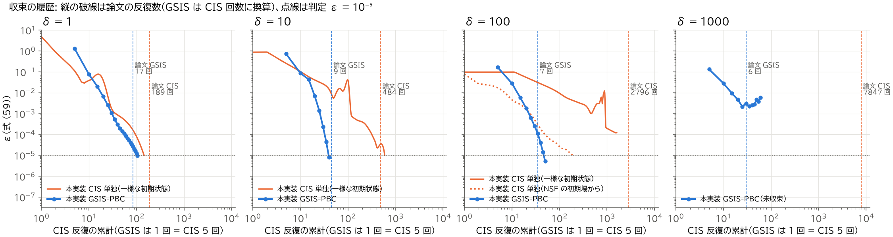
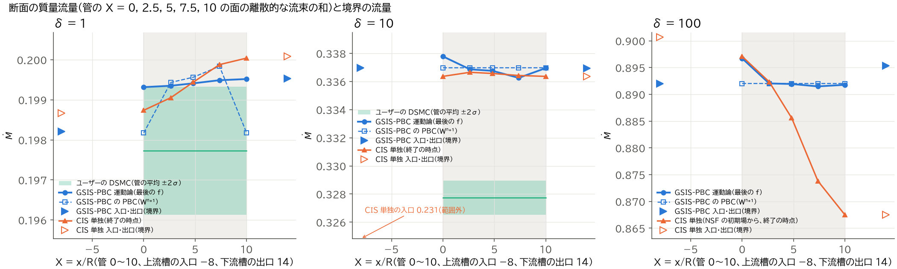
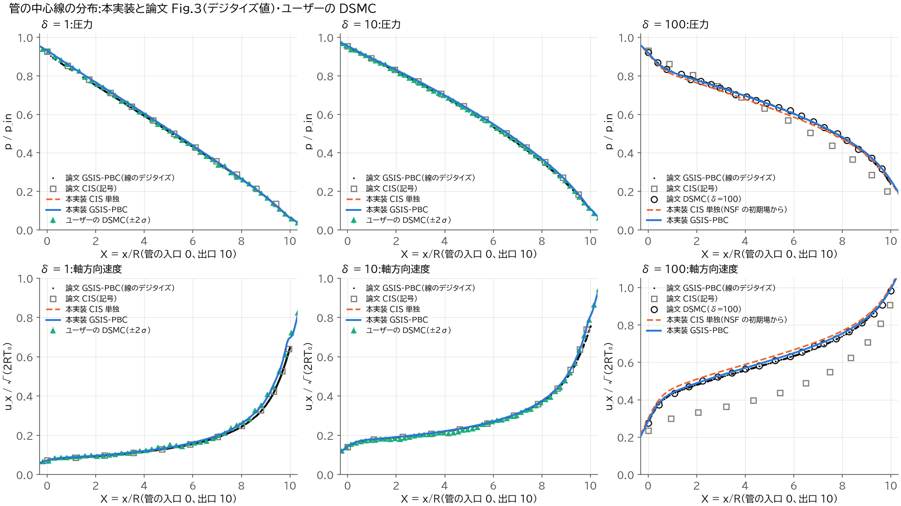
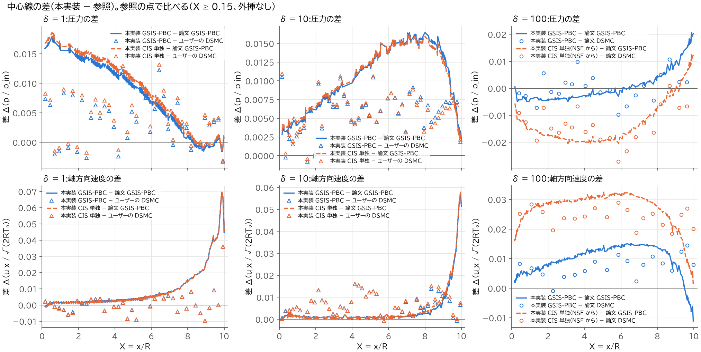
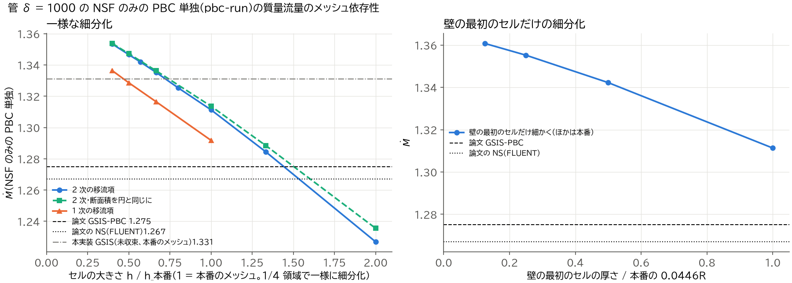

# 再現レポート: 円管 → 真空の 4 条件(arXiv:2610.07658v1 の GSIS-PBC)

- 対象: Y. Zhang, Y. Wen, L. Wu, *A pressure-based coupled general synthetic iterative scheme for rarefied gas flow simulation*,
  arXiv:2610.07658v1(2026-10-06)の §4.1「円管 → 真空」(Table 1、Fig.3)
- 実装: このリポジトリの `gsis-solver`(C++20 / CUDA 13.4)。運動論ソルバーは GPU(RTX 5070 Ti 1 枚)、マクロソルバーは CPU
  (Ryzen 7 7700、8 コア)
- 作成: 2026-10-17(フェーズ 5c)。作業の記録は `docs/phase5c_report.md`、各フェーズの詳細は `docs/phase4_report.md`・
  `docs/phase5_report.md`・`docs/phase5b_d1000_report.md`・`docs/phase5b_d10_report.md`
- 図: `docs/figures/`(本文中の図はすべてここ)。表の元の値は `cases/tube_vacuum/phase5c/results/`

## 0. 要旨

| δ_rp | 本実装 GSIS-PBC の Ṁ(入口 / 出口) | 論文 GSIS-PBC | 差 | 反復(論文) | 時間 | 参照(論文) | ユーザーの DSMC |
|---|---|---|---|---|---|---|---|
| 1 | 0.1982 / 0.1995 | 0.198 | +0.10〜+0.77% | 21(17) | 607 s | DSMC 0.197 | 0.19773 ± 0.00080 |
| 10 | 0.3370 / 0.3369 | 0.326 | **+3.4%** | 8(9) | 272 s | DSMC 0.330 | 0.32773 ± 0.00061 |
| 100 | 0.8920 / 0.8953 | 0.885 | +0.79〜+1.2% | 10(7) | 306 s | DSMC 0.898 | — |
| 1000 | **未解決**(未収束の 1.33) | 1.275 | (+4〜5%) | —(6) | — | NS 1.267 | — |

- δ=1・100 は spec §1.4 の受け入れ基準(Ṁ が論文の GSIS-PBC の ±2% 以内、反復が 2 倍以内)を満たす。δ=10 は反復は満たすが
  Ṁ が +3.4%。δ=1000 は GSIS の反復が収束しない(§6.2)。δ=100 の Ṁ は壁の最初のセルの厚さに 1 次で依存し、細かくすると
  論文の GSIS に +1.5%(外挿で +1.7%、論文の DSMC 0.898 とほぼ同じ)で、基準の内側にとどまる(§4.5)
- δ=10 の差は本実装の数値誤差(速度格子・メッシュ・境界条件で 0.4% 以下)では説明できず、論文の GSIS の不動点がマクロの
  離散化(セル中心の HoT、1 次の移流項)で運動論の解からずれていることが主な原因と考える(状況証拠。§6.1)。本実装の値は
  本実装の CIS 単独の解・論文の CIS の中心線とほぼ一致する
- 1 条件の GSIS-PBC は初期化を含めて 4.5〜10 分(目標 1 時間以内)。論文(96 コア)の 0.09〜0.20 h と同程度
- フェーズ 5c で、収束の判定に**質量の釣り合いの診断**(入口・出口と管の断面の質量流量)を加えた。式 (59) の ε < 10⁻⁵ を満たしても、
  δ=1 では入口と出口が 0.66%、δ=100 では 0.37% 食い違う。どちらも、局所 Kn > 1 で凍結した領域と PBC で動かす領域の境目で GSIS の
  不動点が質量を保存しないため(δ=1 は ε = 10⁻⁷ まで続けても 0.55% で頭打ち。δ=100 は最後の 5 回で ε が 2 桁下がる間、CIS の後の
  差が 0.77% → 0.73% とほぼ一定)で、管を通る流量はそれぞれ 0.1994・0.8920。
  CIS 単独の δ=10 は ε < 10⁻⁵ の時点で入口の流量が出口より 31% 小さい(上流槽が定常に達していない「見かけの収束」)
- CIS 単独(§4.2・§6.4): 本実装の 2 次精度の CIS は、収束すれば GSIS と同じ解になる(δ=1・10 で管の流量が 0.2% 以内)。論文の CIS の
  δ=100 の過小評価(−33.5%)は再現しない。δ=100 は一様な初期状態から 1,602 回でも未収束、NSF の初期場からは 192 回で ε < 10⁻⁵ を
  満たすが入口と出口が 3.7% 食い違う見かけの収束で、途中の状態を出口で測ると過小評価になる
- δ=1000 の NSF のみの PBC 単独が論文の GSIS に +2.8% なのはメッシュの粗さのためではない。細かくすると Ṁ は 1 次で増えて論文から
  離れる(h → 0 で +8%。単独モードの壁の流束の 1 次の誤差。§6.2)
- ユーザーの DSMC(δ=10)の数値誤差は、粒子数を半分で −0.30 ± 0.33%、時間刻みを半分で +0.10 ± 0.34% と統計誤差の範囲で、
  本実装との差 2.1〜2.8% は DSMC の数値誤差では説明できない(§6.5)

## 1. 目的と範囲

- 目的: GSIS-PBC を実装し、論文 §4.1 の円管 → 真空の 4 条件(δ_rp = 1, 10, 100, 1000)の質量流量(Table 1)と中心線の分布
  (Fig.3)を、論文と同じ速度格子・同程度の空間解像度で再現する。比較のため、同じコードで CIS 単独の計算もする(spec §1.1)
- 範囲: Shakhov モデル(単原子 He、Pr = 2/3、μ ∝ T^0.66)、定常解、3 次元の六面体メッシュ。論文のほかの 3 ケース(DGL、
  ダイバータ、球)は扱わない
- 参照: 論文の Table 1(GSIS-PBC・CIS・参照の DSMC/NS)と Fig.3 のデジタイズ値(`reference/paper_2610.07658/`、読み取り誤差 ±0.001)、
  ユーザーの DSMC(3 次元、VHS、1/4 領域。δ=1・10。`docs/dsmc_survey.md`)

## 2. 実装の概要

### 2.1 計算の設定(論文と同じもの)

| 項目 | 値 |
|---|---|
| 形状(R = 管半径) | 上流槽 半径 8・長さ 8、管 半径 1・長さ 10、下流槽 半径 4・長さ 4(同軸)。上流槽の端面は圧力入口(p_in、T0)、下流槽の端面は真空、ほかは完全拡散壁(T0) |
| 条件 | p_in = δ_rp μ0 √(2RT0)/R、He(m = 6.65e−27 kg、μ0 = 1.916e−5 Pa·s @ 273.15 K、ω = 0.66) |
| 速度格子 | 30 × 24 × 24 の一様格子、ξ/√(RT0) ∈ [−10, 10] × [−8, 8]²(区間の中点に点を置き中点則。Δξ = 2/3) |
| 空間格子 | 構造六面体(断面は O 型)135,104 セル(論文は 135,000 セル、形は不明)。管の中 41,984 セル(断面 1,024、軸方向 41 層)、壁の最初のセル 0.045R、槽の最大 0.56R。円は 64 角形(断面積 −0.16%) |
| GSIS | 1 反復 = CIS 5 回 + PBC 10 回、PBC の CFL 500、収束判定 式 (59) の ε < 10⁻⁵ |
| 無次元質量流量 | Ṁ = ṁ / (√π R² p_in / √(2RT0)) |

### 2.2 運動論ソルバー CIS(GPU、FP32)

- 式 (15) を、左辺 1 次風上の陰的演算子・右辺 2 次の定常残差(欠損補正)の LU-SGS で解く(仮定 A1。Δt = ∞)。面の値は
  最小二乗勾配 + Venkatakrishnan のリミッタ(K = 3、f の大きさで規格化)の風上の線形再構成(仮定 A3・A4)
- GPU の並列化: 速度点のチャンク × 空間ブロック(座標の再帰二分割で 64 ブロック、ブロック間はブロック・ヤコビ)。1 回の CIS 反復は、
  速度の向き(体対角 4 方向)ごとにセルの順序をそろえた前進・後退のスイープを、目標分布を固定して 4 回(内部反復。間で拡散壁の流入密度を
  更新)、ブロック間の結合を 2 回反復する(フェーズ 5a の強化、`docs/design_cis_gpu.md` §14)
- 平衡分布は速度格子の上で (ρ, ρu, ρE) を保つ離散平衡(係数をニュートン法で決める。冷たい流れで連続の Maxwell 分布が保存しないため)
- 分布関数 9.3 GB(FP32)+ 作業領域で VRAM 14.4 GB。管の 1 回の CIS 反復は 3.7 s(内部反復 4 回分)
- 集計は atomic を使わず決まった順序で足すので、同じ入力なら結果はビット単位で同じ

### 2.3 マクロソルバー PBC(CPU、FP64)

- 論文の式 (18)–(58) と付録 B・C: Rhie–Chow の面の流量、圧力–速度の連成解法と温度の分離解法、メソとマクロで整合する境界フラックス
  (式 (33)–(38))、擬似時間による安定化(CFL 500)。線形ソルバーは AMGCL の GMRES(30) + ILU0(相対 10⁻³)、OpenMP
- ヤコビアンは差分近似と 10⁻⁸ 未満で一致(単体テスト)。製造解法で u・T は約 2 次

### 2.4 GSIS の反復

- 初期化: 一様な状態 → NSF のみの PBC 単独 50 回(1 次の移流項、CFL を 5 から立ち上げ)→ f = f^eq(W)(仮定 A9)
- 反復: CIS 5 回 → モーメント W^{n+1/2}・σ・q と境界の離散半空間フラックス → HoT を固定した PBC 段(最大 10 回)→ 式 (14) の補正
  → 式 (59)。PBC 段と補正の間で W を CPU と GPU の間でやり取りする(数十 MB)

## 3. 論文との違い(spec §3.7)

論文に書かれていない点は仮定 A1〜A15(`docs/paper_notes.md` §8)で決めた。論文どおりの設定で発散・停滞したために変えた点は、
ユーザーの判断(2026-10-17)で文書に明記して採用した。

| # | 項目 | 本実装 | 論文 | 理由 | 論文どおりにした場合 |
|---|---|---|---|---|---|
| 1 | CIS の解き方 | 速度の向きごとの順序の LU-SGS、内部反復 4 回 + 壁の更新、ブロック間の反復 2 回 | 記載なし(96 コアの CPU) | 1 往復の LU-SGS では、平板の Kn ≥ 1 と管で GSIS が発散・停滞した(PBC 段が平均自由行程より短い波長の誤差を増幅し、CIS が減らしきれない) | 発散・停滞(`docs/phase5_report.md` §4) |
| 2 | 平衡分布 | 速度格子で保存する離散平衡 | 記載なし | δ=1000 の冷たい噴流(T ≈ 0.1)で連続の Maxwell 分布が保存せず、最初の CIS で負の温度 | δ=1000 が始まらない。δ ≤ 100 は結果が変わらない |
| 3 | 局所 Kn > 1 のセルの凍結 | PBC 段で動かさない(補正 0) | なし | 希薄なセルでは NSF の合成方程式(Rhie–Chow の連続式など)が運動論の流束と食い違い、PBC 段が毎回同じ補正を作る。負値の処理で運動論の解が壊れる | δ=1 で出口の Ṁ が 8〜14%、δ=10 で 1.3% ずれる |
| 4 | 補正の低域フィルタ | 補正を ℓ = λ の (V − ∇·ℓ²∇)⁻¹ に通す | なし | フェーズ 4 で発散を抑えるために入れた。CIS の強化の後は不要だが、δ=100 の反復を 17 → 10 回に減らすので残した。収束した解は変わらない | 収束する(δ=100 は 17 回) |
| 5 | 負値の処理 | 補正で生じた負の部分を消す最小の割合で平衡分布と混ぜる(blend) | セルごと置換 | 置換は非平衡の部分を消すので、平板 heat_nl の流束が +2〜79% ずれた | 平板で流束がずれる |
| 6 | 圧力入口の流入の接線速度 | 0(静止した槽からの流入) | 式 (65) で内側から外挿 | 入口を通る旋回・循環のモードが拘束されず、δ=100 で PBC 段が 1 反復 1.65 倍に増幅して発散 | δ=100 が 20 回目以降に発散。δ=1・10 の Ṁ は 10⁻⁵ も変わらない |
| 7 | HoT の面の値 | 面で HoT_f = (σ の補間) − σ^NSF_f(W^{n+1/2}) | セル中心の HoT を補間(式 (30)) | 希薄で粗いセルでセル中心と面の NSF の差が残差を支配し、δ=1 の最初の段が発散 | δ=100 の Ṁ が 0.6% 下がる(0.8865)。δ=10 で −0.7% |
| 8 | PBC の移流項 | 2 次の再構成(フェーズ 5c からコードの既定) | ドナーセル(式 (27)(28))、高次化は任意 | 1 次は GSIS の不動点を動かし、δ=10 で入口と出口の Ṁ が 4% 食い違う | δ=10 で入口 +2.6%・出口 −1.6% |
| 9 | 境界面の再構成(PBC) | δ=100・1000 はセルの値 | 制限付きの再構成 | 入口の層で PBC 段が逆流を作って発散 | δ=100 が 10 回目に発散。不動点は変わらない |
| 10 | δ=1000 だけの設定 | PBC 段の CFL を 5 から立ち上げ、運動論のリミッタ K = 1 と正値の制限、境界セルの勾配の境界値はセルの値、T < 0.1 の目標分布は BGK | CFL 500 固定など | 最初の段の発散、冷たい噴流の負の温度、格子規模のモードの増幅(`docs/phase5b_d1000_report.md`) | 7〜9 回目に負の温度・負の密度で停止 |
| 11 | 収束判定の W | PBC の出力 W^{n+1} と W^n。u の分母に下限 0.01 | どの W かは書いていない | FP32 の雑音で ε_u が下がらない流れがあるため | — |
| 12 | メッシュ | 構造六面体 135,104 セル、64 角形 | 135,000 セル(形は不明) | — | 64 角形の断面積の不足は Ṁ を約 0.26% 小さく見せる(`docs/phase5b_d10_report.md` §4.2) |

## 4. 結果: 質量流量と反復回数

### 4.1 GSIS-PBC(`runs/phase5c/gsis/d*`)

| δ | GSIS 反復(論文) | CIS 回数 | ε | 時間(初期化) | Ṁ 入口 / 出口 | 管の断面 X = 0〜10 | 論文 GSIS との差 | 論文の参照との差 | ユーザーの DSMC との差 |
|---|---|---|---|---|---|---|---|---|---|
| 1 | 21(17) | 105 | 9.9e−6 | 607 s(55 s) | 0.1982 / 0.1995 | 0.1993〜0.1995 | +0.10%(入口)〜+0.77% | DSMC 0.197: +0.61〜+1.3% | 0.19773: +0.24〜+0.90% |
| 10 | 8(9) | 40 | 8.0e−6 | 272 s(42 s) | 0.3370 / 0.3369 | 0.3363〜0.3378 | +3.4% | DSMC 0.330: +2.1% | 0.32773: +2.8% |
| 100 | 10(7) | 50 | 5.2e−6 | 306 s(48 s) | 0.8920 / 0.8953 | 0.8915〜0.8967 | +0.79〜+1.2% | DSMC 0.898: −0.67〜−0.30% | — |
| 1000 | 未収束(ε の最小 2.2e−3、5 回目) | — | — | 1 反復 約 40 s | 1.333 / 1.334(12 回目。PBC 1.332) | 1.327〜1.333(12 回目) | +4.1〜+4.6% | NS 1.267: +4.7〜+5.3% | — |

- 「入口 / 出口」は補正の後の f の境界の離散流束、「管の断面」は管の X = 0, 2.5, 5, 7.5, 10 の断面(セル中心が前後に分かれる
  内部面の層)を通る離散流束の和(§4.4)。結果はフェーズ 5a・5b-1 の計算とビット単位で同じ(診断を足しただけ)
- 1 反復の内訳: CIS 18.4 s(3.7 s × 5)、PBC 6.5〜9.2 s、転送 0.3 s。VRAM 14.4 GB
- 論文の時間(96 コア)は 0.20 h(720 s)・0.11 h(396 s)・0.09 h(324 s)・0.08 h

### 4.2 CIS 単独(論文 Table 1 の CIS の列。`runs/phase5c/cis/d*`)

初期状態は全域が p_in・T0 で静止した平衡分布(論文の CIS の初期状態は書かれていない)。δ=100 はこれに加えて、GSIS の初期化と同じ NSF の
解(PBC 単独 50 回)の平衡分布からも始めた。判定は GSIS と同じ式 (59) の ε < 10⁻⁵。

| δ | 反復(論文) | 時間(論文) | 1 反復 | Ṁ 入口 / 出口 | 管の断面 | 論文の CIS の Ṁ | 論文の GSIS |
|---|---|---|---|---|---|---|---|
| 1 | 145(189) | 535 s(0.43 h) | 3.68 s | 0.1987 / 0.2001 | 0.1987〜0.2000 | 0.198 | 0.198 |
| 10 | 591(484) | 2,182 s(1.05 h) | 3.68 s | **0.2310** / 0.3364 | 0.3364〜0.3367 | 0.348 | 0.326 |
| 100(全域 p_in・静止から) | 1,602 で打ち切り(2,796)。ε = 1.2e−4 | 6,008 s(6.20 h) | 3.74 s | 0.000 / 0.714 | 0.177〜0.711(流れが管に行き渡る途中) | 0.597 | 0.885 |
| 100(NSF の初期場から) | 192(2,796) | 712 s(初期場は GSIS の初期化と同じ設定で作って保存したもの〔`runs/phase5/init/d100.csv`、計算は約 48 s〕を読み込み) | 3.70 s | 0.9007 / **0.8675** | 0.8675〜0.8971(X とともに減る) | 0.597 | 0.885 |

- 本実装の CIS は 2 次精度の空間離散化(リミッタつき)で、1 反復に内部反復 4 回を含む「強い」CIS。論文の CIS(1 反復の中身は
  書かれていない)とは 1 反復の重さが違うので、反復数は桁で比べる
- δ=10 の CIS 単独は、ε < 10⁻⁵ の時点で管の流量(0.3364〜0.3367)は GSIS(0.3363〜0.3378)とそろっているが、入口の流量が 0.2310 と
  31% 小さい。上流槽の質量がまだ動いている(ε の判定は 1 反復の変化の大きさしか見ないので、遅いモードの残りを見逃す)

### 4.3 収束の履歴



- GSIS-PBC は δ=10・100 で CIS 単独より CIS の回数が 1 桁以上少ない(δ=10: 40 ↔ 591 回)。δ=1 は 105 ↔ 145 回でほぼ同じ:
  管と下流槽のほぼ全体(6.6 万セル)が局所 Kn > 1 で凍結され、GSIS が効くのは上流槽だけになる(違い 3)
- δ=1000 は 5 回目に ε = 2.2 × 10⁻³ まで下がった後、上流槽の入口の近くの循環のモードが 1 反復 1.1〜1.2 倍で育つ(§6.2)

### 4.4 質量の釣り合いと断面の質量流量(フェーズ 5c の診断)



| δ | 運動論(最後の f): 入口と出口の相対差 / 断面のばらつき | PBC(W^{n+1}): 相対差 / 断面 | 解釈 |
|---|---|---|---|
| 1 | +0.66% / 0.66% | +0.68% / 断面 0.1982〜0.1998 | 管の中の運動論の断面は 0.1993〜0.1995 でそろい、入口の流量だけが小さい。釣り合いも判定に加えて 42 回(ε = 9.5 × 10⁻⁸)まで続けると、管の 5 つの断面は 0.19942 で出口と一致し、入口(0.1983)と PBC の上流側だけが 0.55% 小さいまま頭打ちになった。収束待ちではなく GSIS の不動点の食い違いで、PBC で動かす上流槽と、局所 Kn > 1 で凍結した管・下流槽(運動論だけ)の境目で生じる(違い 3 の副作用)。Ṁ は管の流量 0.1994 と見るのがよい(フェーズ 2 の CIS 単独を ε < 10⁻⁷ まで回した値 0.1994 と一致) |
| 10 | −0.015% / 0.45% | −0.014% / 断面 0.33697(一定) | PBC の解は保存。運動論の断面は ±0.2% ばらつく(GSIS の不動点は運動論の不動点と少し違う。`docs/phase5b_d10_report.md` §4.5) |
| 100 | +0.37% / 0.59% | +0.38% / 断面 0.89203(一定) | PBC の断面は管の中で一定で入口と同じ。出口との差は凍結した下流槽(噴流の膨張部、局所 Kn > 1)で生じる。CIS の後の f^{n+1/2} の差は最後の 5 回で ε が 2 桁下がる間 0.77% → 0.73% とほぼ一定で、収束待ちではなく δ=1 と同じ不動点の食い違いと考える。管を通る流量は 0.8920 |

ε < 10⁻⁵ でも 0.4〜0.7% の釣り合いの残りがあるので、Ṁ は ±0.3〜0.7% の幅で読むのがよい。既定の許容値 0.2% を超えたので、
3 条件とも警告を出した(`summary.json` の `mass_balance`。δ=10 は最後の f の断面のばらつき 0.45% だけ)。

### 4.5 メッシュ依存性

| δ | メッシュ | Ṁ(入口) | 本番のメッシュとの差 | 出典 |
|---|---|---|---|---|
| 10 | 全体 0.5・0.75・1.5 倍(1/4 領域) | 0.3330・0.3360・0.3377 | −1.18%・−0.29%・+0.20% | フェーズ 5b-2 |
| 10 | 槽を細かく / 管の出入口を細かく | 0.3368 / 0.3368 | −0.05% / −0.05% | フェーズ 5b-2 |
| 10 | 速度格子 Δξ = 1 / 1/2、範囲を広げる | 0.3364 / 0.3371 / 0.3370 | −0.19% / +0.03% / 0.00% | フェーズ 5b-2 |
| 100 | 全体 1.5 倍(1/4 領域) | 0.8960 | +0.44% | フェーズ 5c |
| 100 | 壁の最初のセルだけ 1/4(0.045R → 0.011R) | 0.8979 | **+0.65%** | フェーズ 5c |

- δ=10 はメッシュ・速度格子の誤差が 0.2% 以下で、細かくすると Ṁ はわずかに大きくなる(外挿で 0.338)
- **δ=100 は壁の最初のセルの厚さに依る**(壁のセルが平均自由行程 0.009R より厚い)。運動論の壁の面の流出側の分布をセルから再構成する
  とき、勾配の最小二乗に入れる壁の境界値が流出側ではセルの値(勾配 0 の外挿、仮定 A3)なので、壁に垂直な勾配が小さく見積もられ、
  壁際の流れが遅く出る 1 次の誤差と考える。壁のセルの厚さに 1 次として外挿すると Ṁ ≈ 0.900(論文の GSIS に +1.7%、論文の DSMC 0.898 に
  +0.2%)。本番のメッシュの +0.79% は、この誤差で論文の値に寄っている

## 5. 結果: 中心線の分布(Fig.3)





差 = 本実装 − 参照(参照の点で比べる。X ≥ 0.15、外挿なし。`cases/tube_vacuum/phase5c/results/centerline_diff.csv`):

| δ | 量 | 論文 GSIS の線: 平均 / RMS / 最大(X) | 論文 CIS の記号: RMS | DSMC: 平均 / RMS / 最大(X) | 参考: 論文 GSIS − DSMC の RMS |
|---|---|---|---|---|---|
| 1 | p/p_in | +0.0076 / 0.0096 / 0.018(0.55) | 0.0053 | ユーザー: +0.0037 / 0.0054 / 0.012(6.4) | 0.0081 |
| 1 | u_x/√(2RT0) | +0.016 / 0.025 / 0.070(9.88) | 0.023 | ユーザー: +0.0007 / 0.0071 / 0.036(9.94) | 0.015 |
| 10 | p/p_in | +0.0104 / 0.0113 / 0.017(8.0) | 0.0018 | ユーザー: +0.0058 / 0.0064 / 0.013(3.3) | 0.0063 |
| 10 | u_x/√(2RT0) | +0.0079 / 0.016 / 0.057(9.95) | 0.0036 | ユーザー: +0.0066 / 0.0081 / 0.018(4.5) | 0.0105 |
| 100 | p/p_in | +0.0022 / 0.0074 / 0.021(9.88) | 0.058 | 論文: +0.0002 / 0.0049 / 0.011(8.7) | 0.0059 |
| 100 | u_x/√(2RT0) | +0.0089 / 0.011 / 0.015(6.5) | 0.156 | 論文: +0.0073 / 0.0081 / 0.015(9.6) | 0.0071 |

- δ=1: 本実装はユーザーの DSMC と p・u_x とも統計誤差の範囲で一致する(u_x の RMS 0.007)。論文の GSIS の線は出口の手前(X > 9)で
  u_x が本実装・DSMC より最大 0.07 低い
- δ=10: 本実装は論文の **CIS** の記号と一致する(p の RMS 0.0018、u_x 0.0036)。論文の GSIS の線は論文自身の CIS より p が平均 2%
  低く、本実装との差(+0.0104)はこの論文の GSIS と CIS の差とほぼ同じ。ユーザーの DSMC は p が 1.1%、u_x が 2.8% 低い(§6.1)
- δ=100: 本実装は論文の GSIS の線・論文の DSMC と p で RMS 0.005〜0.007、u_x で 0.008〜0.011 の差。論文の CIS の記号(数値散逸で
  流量を過小評価した解)とは大きく違う
- CIS 単独の中心線は、δ=1・10 では GSIS とほぼ重なる(差 0.001 以下)。δ=100 の CIS 単独(NSF の初期場から、ε < 10⁻⁵ の時点)は
  GSIS より u_x が 2〜4.5% 大きく、p が 0.6〜3% 低い(管の中に質量がたまっていく途中。§6.4)。論文の CIS の記号は p も u_x も
  大きく低い(u_x は 30% 低い)ので、u_x の向きが逆

## 6. 考察

### 6.1 δ=10 の差(論文の GSIS-PBC に +3.4%、DSMC に +2.1〜2.8%)

フェーズ 5b-2 の感度調査(`docs/phase5b_d10_report.md`)の要点:

- 本実装の数値誤差は小さい: 速度格子(Δξ = 2/3 → 1/2 で +0.03%)、メッシュ(1.5 倍細かくして +0.2%)、多角形の断面積(64 角形で
  −0.26%)、入口の接線速度(0.00%)。どれも本実装の Ṁ を小さく見せる向きで、差は縮まらない。メッシュと面積を外挿した本実装の
  GSIS は 0.338
- GSIS の不動点はマクロの離散化に依る: 本実装でも論文の離散化(セル中心の HoT + ドナーセルの移流項)にすると、ε < 10⁻⁵ に収束した
  まま入口 0.344・出口 **0.328** になり、中心線も論文の GSIS の線に近づく(p の差 +2.2% → +0.64%)。論文の GSIS(0.326)は論文自身の
  CIS(0.348)と 6.7% 違い、論文の 2 つの値の平均 0.337 は本実装と同じ。→ 論文との差の主な原因は、論文の GSIS の不動点が運動論の解から
  マクロの離散化の分だけずれていることと考える(状況証拠。論文のメッシュ・リミッタ・Ṁ を測った場所は書かれていない)
- DSMC との差 +2.8%: DSMC の入口(静止した槽から粒子を入れる)で上流槽の圧力が 0.996〜0.998 p_in になる分を補正すると DSMC は
  0.3288〜0.3295、本実装の Shakhov の解は 0.337 前後で、差は 2.2〜2.6%。本実装の断面の分布でも、同じ圧力・圧力勾配で DSMC より
  2〜3% 多く流れる。フェーズ 5c で DSMC の数値誤差を見積もった(§6.5): 粒子数を半分(衝突相手の距離 MCS/λ 0.23 → 0.29)にすると
  Ṁ は −0.30 ± 0.33%、時間刻みを半分(Δt = 0.01 t_ref)にすると +0.10 ± 0.34%(どちらも統計誤差の範囲)。DSMC の数値誤差は
  合わせても 0.5% 程度以下で、差の説明にはならない。残りの約 2% は Shakhov モデルと VHS(Boltzmann)の
  違い(すべり・クヌーセン層の輸送)によると推測する(本実装だけでは分けられない)

### 6.2 δ=1000 が解けない理由

フェーズ 5a・5b-1 で、次の順に問題を見つけて越えた(`docs/phase5_report.md` §6、`docs/phase5b_d1000_report.md`):

| # | 問題 | 対策 | 結果 |
|---|---|---|---|
| 1 | 真空の出口の手前の冷たい噴流(T ≈ 0.1)で、連続の Maxwell 分布が Δξ = 2/3 の速度格子で保存しない(衝突のたびに冷えて密度が増える) | 保存的な離散平衡(違い 2) | 最初の CIS が通る |
| 2 | 最初の PBC 段が CFL 500 で上流槽の淀んだ領域(Ma ≈ 0.01)で発散 | 段の CFL を 5 から立ち上げ | 段が安定 |
| 3 | 噴流の層で運動論ソルバーそのものが不安定(CIS 単独でも 78 回目に負の温度) | リミッタ K = 1 と正値の制限、T < 0.1 の目標分布を BGK に、離散平衡が作れないセルは衝突なし | 19 回まで止まらない |
| 4 | PBC 段の境界セルの勾配に運動論の境界面のモーメントを使うと、1 反復遅れの経路で上流槽の外側の壁の格子規模のモードが 1 反復 2〜2.5 倍で育つ | 境界値をセルの値に(仮定 A7 を変える) | そのモードは消える |
| 5 | **上流槽の入口の近くの循環のモード**(入口の流入の法線速度の分布だけが変わる、PBC の定常問題でほぼ中立なモード)が 1 反復 1.1〜1.2 倍で育つ | HoT の弱め、段の反復数・CFL・緩和、連続式の擬似時間、入口の扱い(W_{i,b}、法線速度の平均化、流入の状態の同期、F⁻ の固定)など約 10 通り | **未解決**(ε は 5 回目の 2.2 × 10⁻³ が最小) |

- 仕組み(見立て): 連続流の領域(上流槽はセルが平均自由行程の数百倍)では、CIS は 1 回で W を衝突時間の分しか動かさないので、GSIS の
  反復は実質「遅れた HoT と境界の整合補正を入れた PBC 段の繰り返し」になる。PBC の定常問題でほぼ中立なモードは、運動論と PBC の
  入口の扱いのわずかな違いで育つ。論文は同じ速度格子で 6 回で収束しているので、論文には書かれていない扱い(CIS の解き方・擬似時間、
  入口・出口の扱い)に違いがあると考える
- 真空の出口の層では運動論の温度が 0.01〜0.03 まで下がり、Δξ = 2/3 の速度格子では表せない(PBC 段が毎回温め、CIS が戻す
  食い違いが毎回 1 万セルで続く)。ε には効かないが、この領域の解は速度格子の解像度で決まっている
- **Ṁ の差(未収束の 1.33、論文の GSIS に +4〜5%)はメッシュの粗さでは説明できない**(フェーズ 5c、図):



  フェーズ 5b-1 は「+4.5% のうち +2.8% は NSF だけの PBC(本番のメッシュで 1.3112)の時点で出ている」とした。NSF だけの PBC
  単独をメッシュを変えて流すと、Ṁ は細かくするほど大きくなり(0.5 倍 1.227 → 本番 1.311 → 2.5 倍 1.353。h にほぼ 1 次、h → 0 の
  外挿で 1.375〜1.38)、壁の最初のセルだけを 1/8 にしても 1.361 になる。原因は単独モードの壁の境界フラックス(壁際のセルの状態の
  半空間 Maxwell 流束。壁のせん断は ρ√(RT/2π) u_c で、NS の滑りなしの μu_c/d の d/(2λ) ≈ 12 倍)で、壁のセルが平均自由行程より
  ずっと厚い δ=1000 では、壁が d − 2λ だけ内側にあるのと同じ 1 次の誤差になる(本番のメッシュで約 −5%。うち壁の最初のセルの
  分が約 −4%)。つまり本番のメッシュの +2.8% は、この −5% と、細かくした NSF(運動論と同じ滑り境界)と論文の GSIS の差
  (約 +8%)が打ち消し合ったもの。メッシュを細かくすると論文から離れるので、δ=1000 の差の原因をメッシュの粗さに求めることはできない。残りの差は、壁の滑り(本実装の NSF の
  極限は滑りの長さ 2λ。FLUENT の NS の設定は論文に書かれていない)、論文のメッシュ・数値の扱いなど、本実装だけでは分けられない
  要因による。なお GSIS では、不動点の境界フラックスは運動論の解の流束(整合補正)なので、この単独モードの誤差は初期値にしか効かない

### 6.3 反復回数

| δ | 本実装 GSIS(CIS 回数) | 論文 GSIS | 比 | 本実装 CIS 単独 | 論文 CIS |
|---|---|---|---|---|---|
| 1 | 21(105) | 17 | 1.24 | 145 | 189 |
| 10 | 8(40) | 9 | 0.89 | 591(見かけの収束) | 484 |
| 100 | 10(50) | 7 | 1.43 | 一様から 1,602 回で未収束 / NSF から 192(見かけの収束) | 2,796 |
| 1000 | 未収束 | 6 | — | — | 7,847 |

- GSIS の反復は 3 条件とも論文の 2 倍以内。δ=1 が多いのは、局所 Kn > 1 で凍結した管と下流槽(6.6 万セル、メッシュの 48%)が CIS の
  速さでしか収束しないため(違い 3)。δ=1 では GSIS の CIS 回数(105)が CIS 単独(145)とほとんど変わらない
- δ=100 は補正の低域フィルタで 17 → 10 回(違い 4)。フィルタなしでは論文の 2.4 倍
- 1 回の CIS 反復の中身は論文に書かれていない。本実装の CIS は 1 反復に LU-SGS の往復 4 回(+ ブロック間の反復)を含む「強い」CIS で、
  論文の CIS より 1 反復が重いと思われる(1 反復 3.7 s ↔ 論文 約 8 s / 96 コア)ので、CIS 単独の反復数は桁で比べる

### 6.4 CIS 単独の比較(数値散逸と見かけの収束)

論文の CIS の列は、δ=1 で GSIS と同じ 0.198、δ=10 で 0.348(GSIS より +6.7%)、δ=100 で 0.597(−33.5%)、δ=1000 で 0.729(−42.5%)。
論文は δ=100・1000 の過小評価を、平均自由行程よりずっと大きいセル(δ=100 で最大 57λ)での運動論のスキームの数値散逸によると
説明している。本実装の結果は次のとおり。

- **本実装の CIS は 2 次精度で、収束すれば GSIS と同じ解になる**: δ=1 は管の流量 0.1987〜0.2000(GSIS 0.1993〜0.1995。ε < 10⁻⁷ まで
  回すと 0.1994)、δ=10 は管の流量 0.3364〜0.3367(GSIS 0.3363〜0.3378)、中心線も GSIS と 0.001 以内で重なる。リミッタ(K = 3、
  f の大きさで規格化)は滑らかな連続流の領域ではほとんど働かず、空間離散化の誤差は O(h²) で小さい。δ=100 も、NSF の初期場から
  始めた CIS 単独は管の入口で 0.897(GSIS 0.892)と、33% の過小評価のような大きな散逸は見られない
- **式 (59) の判定は「見かけの収束」を見逃す**: δ=10 の CIS 単独(全域 p_in・静止から)は 591 回で ε < 10⁻⁵ を満たしたが、
  その時点で入口の流量は 0.231 と管の流量 0.336 より 31% 小さい(上流槽がまだ質量を失っている)。入口で Ṁ を測れば −31%、
  出口・管で測れば GSIS と同じ値になる。論文の CIS の δ=10 の値 0.348 は論文自身の中心線(本実装と一致)と整合せず、このような
  未収束の評価を含む可能性がある(`docs/phase5b_d10_report.md` §3.1)
- **δ=100 の CIS 単独は一様な初期状態からでは定常に近づかない**: 全域 p_in・静止から 1,602 回(1.67 h)回して止めた時点で、
  ε = 1.2 × 10⁻⁴、出口の流量 0.714、管の断面の流量は X = 0 で 0.177 → X = 10 で 0.711、入口の流量は 0.000。下流側から上流へ
  希薄化(流れ)が進んでいる途中で、管の入口の断面に流れが届き始めたのは 1,400 回目以降(1,000 回目の X = 0・5・10 の断面の流量は
  0.000・0.159・0.806)。連続流の領域では Δt = ∞ の CIS は 1 回で衝突時間の分しか状態を動かさないので、上流槽(8R)と管を情報が
  渡るのに数千回以上かかる。論文の CIS(2,796 回で ε < 10⁻⁵、Fig.3 の中心線は管の全体で流れがある形)は、初期状態か CIS の解き方
  (擬似時間など)が本実装と違うと考える(論文に書かれていない)。なお、この途中の状態の出口の流量(1,000 回目 0.81、1,600 回目 0.71)は
  論文の CIS の 0.597 と同じ程度の大きさで、ε の判定で止めた途中の状態を出口で測れば、数値散逸がなくても大きく過小評価しうる
- **δ=100 を NSF の初期場(GSIS の初期化と同じ)から始めると、192 回で ε < 10⁻⁵ を満たすが、これも見かけの収束**: 管の断面の流量が
  X = 0 の 0.897 から X = 10 の 0.867 まで 3.4% 減り、入口 0.901・出口 0.867(差 3.7%)。流れ込む方が多く、管の中に質量がたまっていく
  途中(管の圧力は GSIS より 0.6〜3% 低く、u_x は 2〜4.5% 大きい)。出口で測れば論文の GSIS に −2.0%、本実装の GSIS に −2.8% の過小評価、
  入口で測れば本実装の GSIS に +1.0% になる
- 反復の桁: δ=1 で 145 回(論文 189)、δ=10 で 591 回(論文 484)と同じ桁。δ=100 は初期状態で大きく変わり(一様から 1,600 回でも未収束、
  NSF から 192 回で見かけの収束)、論文の 2,796 回・0.597 はどちらとも合わない。本実装の 1 回の CIS 反復は LU-SGS の往復 4 回を
  含むので、往復の回数では論文の数倍になる可能性がある(論文の 1 反復の中身は不明)

### 6.5 DSMC の数値誤差の見積もり(ユーザーの DSMC、δ=10)

| 計算 | 設定 | Ṁ(管のスラブの平均) | d10_q との差 | 時間 |
|---|---|---|---|---|
| `d10_q`(本計算) | Δx = R/10、28 粒子/セル(MCS/λ ≈ 0.23)、Δt = 0.02 t_ref、18,000 ステップ | 0.32773 ± 0.00061 | — | 2.1 h |
| `d10_q_ppc14` | 14 粒子/セル(MCS/λ ≈ 0.29) | 0.32676 ± 0.00090 | −0.30 ± 0.33% | 1.0 h |
| `d10_q_dt` | Δt = 0.01 t_ref(τ/Δt ≈ 7)、30,000 ステップ(300 t_ref) | 0.32807 ± 0.00095 | +0.10 ± 0.34% | 2.9 h |

- どちらも差は統計誤差(1σ)の範囲で、DSMC の粒子数・時間刻みの誤差は Ṁ で 0.5% 程度以下。本実装(Shakhov)との差 2.1〜2.8% は
  DSMC の数値誤差では説明できない(§6.1)
- 平均は同じ物理時間 140 t_ref 以降(本計算・`d10_q_ppc14` は 11 ブロック、`d10_q_dt` は 8 ブロック)。後半と前半の差の z は
  本計算 −0.20、`d10_q_ppc14` −2.25、`d10_q_dt` −0.88。入口の面の圧力は 3 本とも 0.998 p_in(上流槽 0.996 p_in)で同じ
- 中心線(論文の GSIS の線との差の RMS)も `d10_q_dt` で p 0.0061・u_x 0.0113 と本計算と同程度

### 6.6 性能

| 項目 | 本実装(RTX 5070 Ti 1 枚 + Ryzen 7 7700 8 コア) | 論文(Xeon Silver 4208、96 コア) |
|---|---|---|
| GSIS-PBC 1 条件(初期化を含む) | δ=1: 607 s、δ=10: 272 s、δ=100: 306 s | 0.20 h(720 s)、0.11 h(396 s)、0.09 h(324 s) |
| GSIS 1 反復 | 26〜29 s(CIS 5 回 18.4 s〔GPU〕、PBC 段 6.5〜9.2 s〔CPU〕、転送 0.3 s) | 約 40 s(時間 / 反復) |
| 初期化(NSF の PBC 単独 50 回) | 42〜55 s | — |
| CIS 1 反復 | 3.68 s(LU-SGS の往復 4 回 + ブロック間の反復 2 回) | 約 8 s(0.43 h / 189 回) |
| メモリ | VRAM 14.4 GB(f は FP32 で 9.3 GB) | — |
| GSIS の CIS 単独に対する速さ | δ=1: 0.88 倍、δ=10: 8.0 倍、δ=100: 20 倍以上(CIS は一様な初期状態から 1,602 回・6,008 s で未収束。NSF からは 192 回・760 s で見かけの収束) | 2.2 倍、9.5 倍、68.9 倍 |

- spec の性能目標(1 条件 1 時間以内)を満たす。GPU 1 枚で論文の 96 コアと同程度の時間
- 時間の 7 割は CIS(GPU)。PBC 段(CPU)は 25〜32%。δ=1 では凍結した領域のために GSIS の利点が出ない

## 7. 受け入れ基準(spec §1.4)の達成状況

| 項目 | 基準 | δ=1 | δ=10 | δ=100 | δ=1000 |
|---|---|---|---|---|---|
| Ṁ | 論文の GSIS-PBC の ±2% 以内 | **達成**(+0.10%、管・出口で +0.77%) | **未達**(+3.4%) | **達成**(+0.79%、出口で +1.2%。壁のセルを細かくすると +1.5%、外挿で +1.7%) | **未達**(GSIS が収束しない。未収束の値 +4〜5%) |
| 参照との差 | 併記 | DSMC: 論文 +0.6%、ユーザー +0.2% | DSMC: 論文 +2.1%、ユーザー +2.8% | DSMC(論文): −0.7%(壁のセルを細かくすると 0.0%) | NS: +5%(未収束) |
| GSIS の反復 | 論文の 2 倍以内 | **達成**(21 / 17) | **達成**(8 / 9) | **達成**(10 / 7) | **未達** |
| CIS 単独 | δ=100・1000 の過小評価の傾向と、反復の桁(189〜7,847) | 145 回(論文 189)・Ṁ 0.199 | 591 回(論文 484)・管 0.336(入口は見かけの収束で 0.231) | **一部**: 一様から 1,602 回で未収束(出口 0.714)、NSF から 192 回で見かけの収束(出口 0.867、−2%)。過小評価の傾向は出口で測れば出るが、論文の −33.5% の大きさは再現しない | 計算していない |
| 中心線 | Fig.3 との差を定量的に報告 | **報告**(論文 GSIS と p の RMS 0.010・u_x 0.025、DSMC と 0.005・0.007) | **報告**(論文 GSIS と 0.011・0.016、論文 CIS と 0.002・0.004) | **報告**(論文 GSIS と 0.007・0.011、論文 DSMC と 0.005・0.008) | 論文に図なし |
| 性能 | 1 条件 1 時間以内 | **達成**(10 分) | **達成**(4.5 分) | **達成**(5.1 分) | — |

## 8. 未解決の点と今後の課題

1. **δ=1000 の GSIS が収束しない**(§6.2)。上流槽の入口の近くの循環のモードが育つ。候補: PBC 段で入口のパッチ全体を結ぶ陰的な扱い、
   上流槽の中立なモードを抑える PBC の離散化の見直し、論文の CIS の解き方(擬似時間など)との違いの調査
2. **δ=10 の Ṁ が論文の GSIS より +3.4%**(§6.1)。論文の GSIS の不動点の偏り(マクロの離散化)という説明は状況証拠で、論文の
   データ(メッシュ・Ṁ を測った場所・リミッタ)がないと確かめられない
3. **Shakhov(本実装)と DSMC(VHS)の約 2% の差**(δ=10)。DSMC の数値誤差は粒子数で −0.3 ± 0.3%、時間刻みで +0.1 ± 0.3% と小さい。モデルの違いを
   切り分けるには、線形の Poiseuille 流れの流量係数を Sharipov の S モデル・剛体球の表と比べる計算が使える
4. **ε < 10⁻⁵ でも残る質量の釣り合いの差**(δ=1 で 0.66%、δ=100 で 0.37%)。δ=1 は ε = 10⁻⁷ まで続けても 0.55% で頭打ち(δ=100 も
   ε が下がる間ほぼ一定)で、   局所 Kn > 1 で凍結した領域と PBC で動かす領域の境目で GSIS の不動点が質量を保存しない(凍結の副作用)。凍結をなくす(希薄なセルでも
   NSF の合成方程式が運動論と食い違わない PBC の離散化にする)か、凍結した領域の境目の流束を運動論の流束に合わせる扱いが課題。
   `[gsis].mass_balance_required = true` は、この食い違いを見つけるのには使えるが、食い違いがあると判定を満たさない
5. **論文との違い(§3)のうち、局所 Kn > 1 の凍結、入口の接線速度 0、負値の blend、面の HoT は、本実装では安定のために要る**。
   論文がこれらなしで解けている理由(CIS の解き方、境界フラックスの細部など)は分かっていない
6. **連続流の壁際の 1 次の誤差**: 単独モードの PBC は壁のセルの状態の半空間流束で壁のせん断を決めるので、δ=1000 では壁のセルの厚さに
   1 次で依存する(§6.2)。GSIS の運動論の壁の流束(壁の面へ再構成した f)も、勾配の最小二乗の壁の境界値が流出側でセルの値(仮定 A3)
   なので、平均自由行程が壁のセルより短い δ=100 で壁の最初のセルに依る(1/4 にして +0.65%、§4.5)。壁際の勾配の境界値の改善
   (片側の外挿など)と、δ ≥ 100 での壁の層の細分化が課題
7. 試していないもの: 四面体・多面体のメッシュでの GSIS(正値の制限の効果)、δ=1000 の CIS 単独の収束解、δ=1000 の DSMC
   (3 次元の DSMC では計算量が大きすぎる)

## 付録 A. 再現の手順

ビルド(`docs/build.md`):

```powershell
. .\cmake\vs_dev_env.ps1
cmake --preset release -B build/phase5c
cmake --build build/phase5c
ctest --test-dir build/phase5c        # 152 件
```

計算(リポジトリのルートから。GPU を 14.4 GB 使うので 1 本ずつ。`runs\.gpu_lock` の順番待ちは `CLAUDE.md`):

```bash
uv run --project python --no-sync python cases/tube_vacuum/phase5c/make_cases.py     # ケースの TOML
# GSIS-PBC(δ = 1, 10, 100)
build/phase5c/src/gsis-solver.exe run cases/tube_vacuum/phase5c/tube_d10_p5c.toml --out runs/phase5c/gsis/d10 --cells-csv
# CIS 単独(全域 p_in・静止から)
build/phase5c/src/gsis-solver.exe run cases/tube_vacuum/phase5c/tube_d10_p5c.toml --mode cis --out runs/phase5c/cis/d10 --cells-csv
# CIS 単独 δ=100 を NSF の初期場から(初期場は `run ... --save-init <CSV>` で保存したもの)
build/phase5c/src/gsis-solver.exe run cases/tube_vacuum/phase5c/tube_d100_p5c.toml --mode cis --init-from runs/phase5/init/d100.csv --out runs/phase5c/cis/d100_nsf --cells-csv --max-iter 600
# δ=1 を質量の釣り合いも判定に加えて(§4.4)
build/phase5c/src/gsis-solver.exe run cases/tube_vacuum/phase5c/tube_d1_p5c.toml --out runs/phase5c/gsis/d1_mb --init-from runs/phase5/init/d1.csv --set gsis.mass_balance_required=true --max-iter 80
# δ=100 のメッシュ依存性(1/4 領域。base・r150・dsw025)
build/phase5c/src/gsis-solver.exe run cases/tube_vacuum/phase5c/tube_d100_q_dsw025.toml --out runs/phase5c/gsis_q/d100_q_dsw025 --cells-csv --no-vtu
# δ=1000(未解決。フェーズ 5a の NSF の初期場から)
build/phase5c/src/gsis-solver.exe run cases/tube_vacuum/phase5c/tube_d1000_p5c.toml --out runs/phase5c/gsis/d1000 --init-from runs/phase5/init/d1000.csv --max-iter 12
# δ=1000 の NSF のみの PBC 単独のメッシュ依存性(CPU)
uv run --project python --no-sync python cases/tube_vacuum/phase5c/d1000_mesh_study.py make
uv run --project python --no-sync python cases/tube_vacuum/phase5c/d1000_mesh_study.py run
uv run --project python --no-sync python cases/tube_vacuum/phase5c/d1000_mesh_study.py summary
# 表と図
uv run --project python --no-sync python cases/tube_vacuum/phase5c/summarize.py
uv run --project python --no-sync python cases/tube_vacuum/phase5c/centerline_compare.py
uv run --project python --no-sync python cases/tube_vacuum/phase5c/d1000_mesh_study.py plot
```

DSMC(`docs/dsmc_survey.md` §7): `pwsh -File validation\dsmc\run_dsmc.ps1 -Case d10_q -RunName d10_q`、後処理は
`uv run --project python --no-sync python validation/dsmc/tools/analyze_tube.py validation/dsmc/runs/d10_q --steady-from 7200`。

| 成果物 | 場所 |
|---|---|
| 計算の出力 | `runs/phase5c/gsis/`・`cis/`・`gsis_q/`・`d1000_nsf/`、DSMC は `validation/dsmc/runs/` |
| ケース・メッシュ・スクリプト | `cases/tube_vacuum/phase5c/`(細かいメッシュは `mesh/`) |
| 表 | `cases/tube_vacuum/phase5c/results/`(`tube_results.csv`・`centerline_diff.csv`・`d1000_nsf_mesh.csv`) |
| 図 | `docs/figures/`(`centerline_tube.png`・`centerline_diff.png`・`convergence_history.png`・`section_mass_flow.png`・`d1000_nsf_mesh.png`) |
